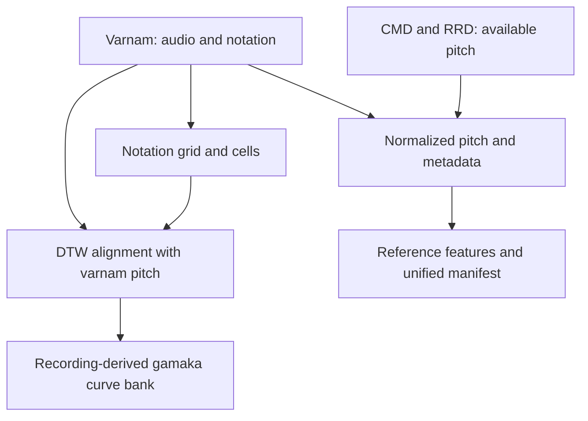
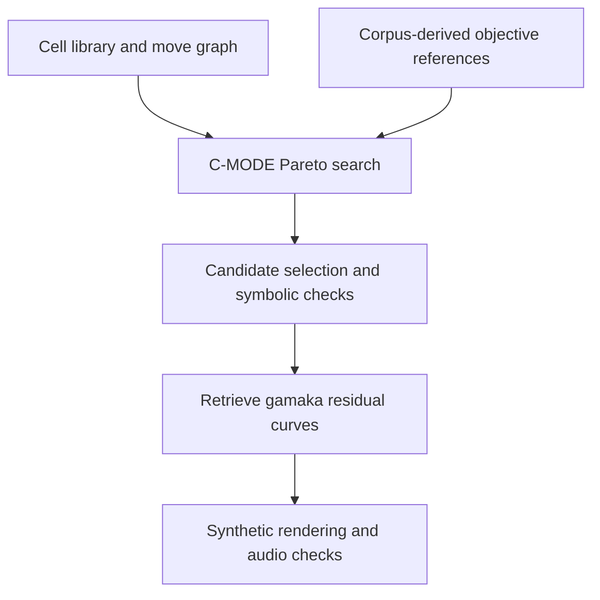
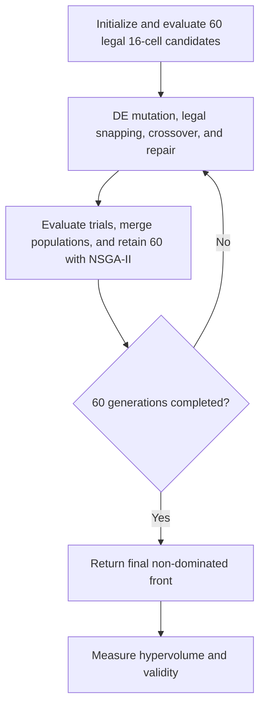
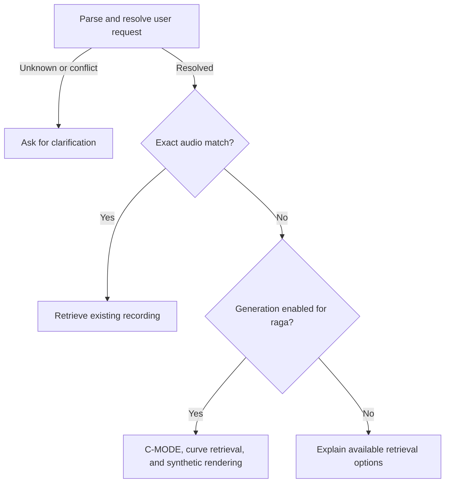

# GenRaga: editable flowcharts and recreation guide

The PDF renders these four diagrams as vector graphics using TikZ. The Mermaid versions below provide an alternative editable representation, not a new or extended system design. Figure numbering follows the full manuscript's order of appearance, rather than the earlier planning document.

## Figure 1. Source-specific data preparation

Location: Section III-B, Metadata and Pitch Preprocessing.

**Caption:** Source-specific preparation. RRD contributes pitch, not audio; gamaka curves are extracted from aligned varnam recordings only.

**Recreate in Word or Draw.io:** Arrange two source boxes across the top. Put the notation grid under varnam and normalization under the pitch sources. Connect varnam to both branches. The notation branch and varnam pitch enter DTW; its output is the curve bank. Normalized metadata/pitch feeds the manifest and statistical references. Never connect RRD directly to an audio or notation input.

## Figure 2. Overall GenRaga generation workflow

Location: Section IV-A, System Architecture.

**Caption:** GenRaga's generation branch. Objective references and cell legality enter search separately; audio consistency is checked after rendering.

**Recreate:** Place two input rectangles side by side, then a centered vertical sequence: C-MODE, candidate selection/checks, gamaka retrieval, and audio rendering/checks. Draw arrows from both inputs into C-MODE. This represents generation only; retrieval of an existing recording belongs to Figure 4.

## Figure 3. Cell-based C-MODE optimization loop

Location: Section IV-B/IV-E, Differential Evolution and NSGA-II Selection.

**Caption:** Benchmark C-MODE loop. Section-wise audio generation uses a different population and generation count.

**Recreate:** Use three process boxes, one termination diamond, and an output box. Loop the “No” branch back to mutation, not initialization. The initial evaluation is counted once. The benchmark budget is 60 × 61 = 3,660 candidate evaluations. The actual snapping code includes an unrestricted fallback when the masked candidate set is empty; observed validity is checked, not asserted as an unconditional guarantee.

## Figure 4. Request routing and module interaction

Location: Section IV-G, Request Routing and Retrieval.

**Caption:** Request routing. The generation branch is separate from retrieval of genuine source recordings.

**Recreate:** Begin with parsing/resolution and a side exit for clarification. Use two decision diamonds for exact audio availability and generation support. Label all “Yes”/“No” edges. Use separate terminal boxes for real-recording retrieval, synthetic generation, and explanation. The router has not been benchmarked for request accuracy in the supplied experiments.

## Figure 5. Hypervolume comparison chart

Location: Section VI-A, Optimization Performance.

This is a results chart rather than a flowchart. It is regenerated from the existing `v2_outputs/v2_runs.csv` records by `analyze_saved_results.py`. The output is `figures/hypervolume.pdf` (vector) and `figures/hypervolume.png` (preview). Bars show means and error bars show sample standard deviations over five seeds. No synthetic or illustrative data are substituted.

## Figure formatting

- Use simple black outlines and readable text; do not rely on color to distinguish flowchart branches.
- Place captions below figures and cite each figure in the accompanying prose.
- Retain vector output for the IEEE manuscript.
- Preserve the separation between the 16-cell optimizer benchmark and the 56-cell rendered-piece evaluation.
- Do not add a neural gamaka generator to the deployed pipeline; the learned model did not generalize and is not used.
